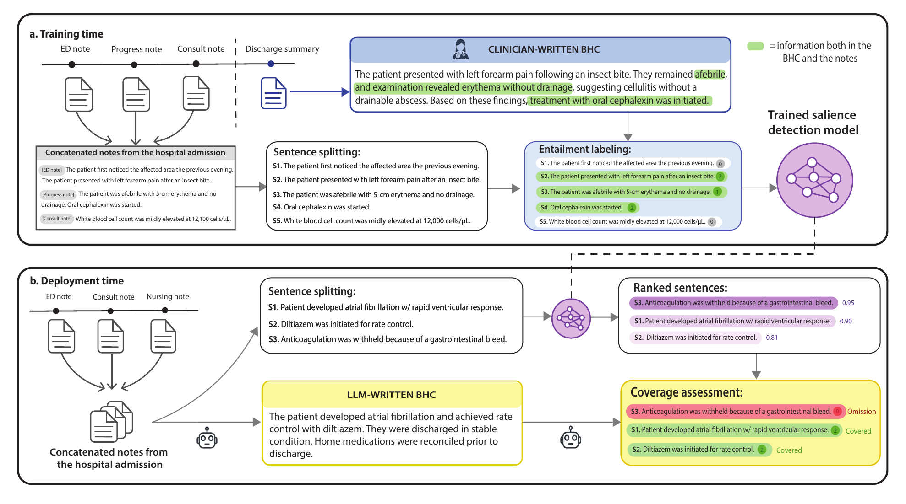

# OmitEHR: Scalable Omission Detection in LLM-Generated Clinical Summaries

A reference-free framework that learns clinical salience from historical clinician-written summaries to identify clinically important information missing from LLM-generated summaries.




## Overview

OmitEHR separates omission detection into two tasks: predicting which information in a patient's electronic health record (EHR) is clinically salient and determining whether that information is covered by a generated summary. By learning salience offline, OmitEHR avoids costly LLM-based importance judgments at inference time.

Given an admission's source notes and the corresponding Brief Hospital Course (BHC) summary, OmitEHR follows a four-stage pipeline:

1. **Preprocess:** Clean and segment source notes into sentence-level chunks, with optional removal of templated and copy-forward text;

2. **Predict salience:** Score each sentence using a model trained to predict which information clinicians would include in a BHC, based on historical EHR–summary pairs.

3. **Assess coverage:** Select the highest-salience sentences and use an LLM-judge to determine whether their clinical content is represented in the provided BHC.

4. **Surface omissions:** Rank salient but uncovered sentences as candidate omissions, with optional note-grounded rationales to support clinician review.


The repository is organized as a small Python package:
reusable code lives under `omitehr/`, while data, checkpoints, and generated
JSONL files can live anywhere outside the repository.

## Layout

```text
omitehr/
├── omitehr/
│   ├── pipeline/    # preprocessing, salience inference, BHC generation, TRACE, ranking
│   ├── models/      # train/evaluate the neural models and run baselines
│   ├── utils/       # metadata, filtering, chunking, embeddings, evaluation, API helpers
│   └── llm_backend/ # pluggable LLM client interface (bring your own credentials)
├── pyproject.toml
├── requirements.txt
└── README.md
```

The two main model choices are:

- `omitehr.models.finetune_sentence_classifier`: sentence-level encoder fine-tuning.
- `omitehr.models.end_to_end_record_context`: admission-aware end-to-end model.

`omitehr.models.record_context` trains the same context architecture from
precomputed embeddings, and `omitehr.models.frozen_encoder_heads` trains a
logistic/MLP head with a frozen encoder. `omitehr.models.baselines` exposes
the heuristic and lexical baselines.

## Install

Use Python 3.10 or newer in a dedicated environment:

```bash
python -m venv .venv
source .venv/bin/activate
python -m pip install -e .
```

TRACE is optional. Install it if you want copy-forward/template removal:

```bash
python -m pip install -e '.[trace]'
```

## LLM backend (bring your own)

Four stages call out to an LLM: `omitehr.utils.contextual_chunk_labeler`,
`omitehr.pipeline.generate_bhc`, `omitehr.pipeline.coverage_labeler`, and
`omitehr.pipeline.omission_rationalizer`. They all go through one small,
swappable interface in `omitehr/llm_backend/`, rather than any specific
vendor SDK or gateway:

```text
omitehr/llm_backend/
├── openai_client.py      # get_async_openai_client()
├── anthropic_client.py   # get_async_anthropic_client()
├── gemini_client.py      # get_async_gemini_client()
└── cost_tracking.py      # log_call() / price_for() -- optional, no-op by default
```

Each file ships as a placeholder that raises `NotImplementedError`. Before
running a stage, implement whichever file matches the provider inferred
from the `--model` you pass it (see each file's docstring for the exact
method the pipeline calls and how it reads the response and token usage).
For example, filling in `openai_client.py` with the official `openai`
package's `AsyncOpenAI` client, using your own API key from the
environment, is enough to satisfy every OpenAI-model stage. Keep API keys
in the environment or a local `.env` (never in JSONL or git) using whatever
variable names your own implementation reads.

`cost_tracking.py` is left as a working no-op rather than a placeholder, so
implementing it is optional -- the pipeline still counts calls/tokens
without it.

Each stage also accepts `--provider {openai,anthropic,gemini}` to override
provider inference for custom model names, and `--model-options` JSON
for generation options supported by your client (Gemini: `config` fields).

## Data availability

This repository contains **code only**. The clinical notes and discharge
summaries used in the study are protected health information and cannot be
redistributed, and no data, model checkpoints, or derived artifacts are
included. To run the pipeline, supply your own admission records in the JSONL
schema described below (at minimum `doc_id`, `person_id`,
`visit_occurrence_id`, and `source_text`).

**No study-trained model weights are distributed.** Train on your own data
before prediction. The checkpoints in the commands below are local outputs
created by the training commands, not files included with this release.

## End-to-end pipeline

Commands use these placeholders:

```bash
ROOT=/path/to/omitehr
DATA=/path/to/data
RUN=$DATA/omitehr_run
mkdir -p "$RUN"
```

Input is JSONL with at least `doc_id`, `person_id`, `visit_occurrence_id`, and
`source_text` (the flattened notes for one admission). For model training,
retain the preprocessing output, including `atomic_chunk_metadata`, and add
aligned `contextual_label_values` (or legacy `entailment_labels`) from the
labeling stage. Do not construct training rows from just sentence text and
labels: the models also consume note metadata. The pipeline preserves extra
fields and writes intermediate JSONL so each stage can be inspected or rerun.

Each source note should start with a header on its own line:

```text
NOTE_DATETIME: 2026-01-01 08:00:00 | NOTE_TITLE: Progress note
The patient developed a fever. Treatment improved the symptoms.
```

`source_text` concatenates these notes in chronological order. For supervision,
put the clinician-written **BHC itself** in `target_text` (or select its field
with `--bhc-field`), rather than the complete discharge summary. Preprocessing
preserves this reference and produces the aligned sentences and note metadata.
Re-running preprocessing invalidates previous sentence labels; label afterward.

### 1. Remove repeated note text with TRACE (optional)

Run this before preprocessing when TRACE is desired. It produces note-level
TRACE output, cleaned admission records, and a metrics file.

```bash
python -m omitehr.pipeline.trace_clean \
  --input_jsonl "$DATA/admissions.jsonl" \
  --trace_output_jsonl "$RUN/trace.jsonl" \
  --cleaned_output_jsonl "$RUN/admissions_clean.jsonl" \
  --metrics_json "$RUN/trace_metrics.json"
INPUT="$RUN/admissions_clean.jsonl"
```

Without TRACE, set `INPUT="$DATA/admissions.jsonl"` and continue.

### 2. Split notes, make atomic chunks, and apply filters

```bash
python -m omitehr.pipeline.preprocess \
  --input-jsonl "$INPUT" \
  --output-jsonl "$RUN/preprocessed.jsonl"
```

### 3. Generate contextual salience labels

When labels are not already present, use the clinician-written BHC as the
reference and label every retained source chunk with Prompt A. The labeler
writes both auditable structured labels and the aligned
`contextual_label_values` field consumed by model training.

```bash
python -m omitehr.utils.contextual_chunk_labeler \
  --input-jsonl "$RUN/preprocessed.jsonl" \
  --output-jsonl "$RUN/contextual_labels.jsonl" \
  --model gpt-5-mini \
  --batch-size 25 \
  --max-output-tokens 3000 \
  --max-concurrency 3 \
  --checkpoint \
  --resume
```

The input must contain a clinician-written BHC in `target_text` and aligned
`source_sentences_valid` chunks. Do not use the generated-BHC omission
coverage stage to create training labels.

### 4. Train a salience model

Prepare train/dev/test JSONL files in the same record format, then train either
the fine-tuned sentence model or the admission-aware model. Both write a
checkpoint and a metrics JSON file. Split by patient before training so the
same patient's admissions do not cross train/dev/test boundaries.

All four training CLIs and the baseline evaluation CLI accept
`--positive-label 1` (default: labels 1 and 2 are positive) or
`--positive-label 2` (only label 2 is positive; 0 and 1 are negative).
Null labels are excluded from supervised training/evaluation. The selected
definition applies to all splits and is saved with the checkpoint/results;
prediction uses the checkpoint's learned target. It does not change the
three-class LLM labeling rubric or the omission coverage threshold.

```bash
python -m omitehr.models.finetune_sentence_classifier \
  --model_name /path/to/clinical-bert-or-roberta \
  --train_jsonl "$DATA/train_contextual_labels.jsonl" \
  --dev_jsonl "$DATA/dev_contextual_labels.jsonl" \
  --test_jsonl "$DATA/test_contextual_labels.jsonl" \
  --output_json "$RUN/finetune_results.json" \
  --checkpoint "$RUN/finetune.pt"
```

```bash
python -m omitehr.models.end_to_end_record_context \
  --model_name /path/to/RoBERTa-large-PM-M3-Voc-hf \
  --train_jsonl "$DATA/train_contextual_labels.jsonl" \
  --dev_jsonl "$DATA/dev_contextual_labels.jsonl" \
  --test_jsonl "$DATA/test_contextual_labels.jsonl" \
  --output_json "$RUN/context_results.json" \
  --checkpoint "$RUN/context.pt" \
  --test_predictions "$RUN/salience.jsonl" \
  --train_max_sentences 1024 \
  --eval_max_sentences 1024 \
  --position_capacity 1024 \
  --chunked_blocks \
  --unfreeze_last_n 8 \
  --gradient_checkpointing
```

For a frozen encoder, create embeddings for each split. `--model` accepts a
compatible Hugging Face encoder identifier or local path; `--pooling` selects
`mean` or `max`. Use the same encoder and settings for all splits and inference.

```bash
python -m omitehr.utils.embeddings \
  --input_jsonl "$DATA/train_contextual_labels.jsonl,$DATA/dev_contextual_labels.jsonl,$DATA/test_contextual_labels.jsonl" \
  --output_jsonl "$RUN/train_embeddings.jsonl,$RUN/dev_embeddings.jsonl,$RUN/test_embeddings.jsonl" \
  --model /path/to/clinical-bert-or-roberta

python -m omitehr.models.frozen_encoder_heads \
  --train_npz "$RUN/train_embeddings.npz" \
  --test_npz "$RUN/test_embeddings.npz" \
  --classifier logistic \
  --positive-label 2 \
  --results_json "$RUN/frozen_results.json" \
  --save_predictions
```

The existing sentence metadata/representation variants, context depth and
ranking losses, frozen-context model (`omitehr.models.record_context`), and
frozen heads (`logistic`, `mlp`, `torch_mlp`; embeddings or TF-IDF) are
configured through each trainer's `--help`. Frozen heads retain
three-class training by default; `--collapse_before_training` enables binary
training, and `--positive-label 2` enables it automatically. When reusing a
locally trained head, keep its original features and label definition.

### 5. Generate the BHC from the full source

The standard BHC is generated from the complete cleaned admission source. This
is the target used to decide which source sentences were omitted.

```bash
python -m omitehr.pipeline.generate_bhc \
  --input-jsonl "$RUN/preprocessed.jsonl" \
  --output-jsonl "$RUN/bhc.jsonl" \
  --source-field source_text
```

### 6. Score salience and select review candidates

Score every source sentence in each BHC record, then retain the 100 highest-
scoring, non-duplicate candidates per admission. The salience command accepts
unlabeled preprocessed/BHC records; labels are required only in the
train/dev/test files.

```bash
python -m omitehr.pipeline.salience \
  --input-jsonl "$RUN/bhc.jsonl" \
  --checkpoint "$RUN/context.pt" \
  --output-jsonl "$RUN/salience.jsonl" \
  --model-name /path/to/RoBERTa-large-PM-M3-Voc-hf

python -m omitehr.pipeline.select_omission_candidates \
  --input-jsonl "$RUN/bhc.jsonl" \
  --salience-jsonl "$RUN/salience.jsonl" \
  --output-jsonl "$RUN/candidates.jsonl" \
  --top-k 100
```

`salience` runs the main contextual model trained in step 4. It reads that
local checkpoint's architecture and tokenization settings; `--model-name`
must identify the encoder used for training. The other model variants retain
their existing training/evaluation commands and prediction outputs.

Candidate deduplication has its own `--dedupe-model` and
`--dedupe-threshold`; use `--dedupe-device cpu` without a GPU. You can also
supply salience scores from an external model: one JSONL row per source chunk,
`{"doc_id": "...", "sentence_idx": 0, "score": 0.9}`, with higher scores meaning
more salient. Indices must cover every chunk exactly once.

### 7. Label coverage and rank omissions

Use an LLM to assess coverage of the selected candidates in the BHC,
with local source-note context. Sentences assigned coverage label 0 (not
related to a BHC claim) are candidate omissions; ranking is deterministic by
salience score. The top 10 omissions per admission can then be prepared for
clinician review.

```bash
python -m omitehr.pipeline.coverage_labeler \
  --input-jsonl "$RUN/candidates.jsonl" \
  --output-jsonl "$RUN/coverage.jsonl" \
  --candidate-field salient_sentences \
  --candidate-index-field salient_sentence_indices \
  --context-mode surrounding \
  --model gemini-2.5-pro \
  --batch-size 10

python -m omitehr.pipeline.rank_omissions \
  --input-jsonl "$RUN/coverage.jsonl" \
  --output-jsonl "$RUN/ranked.jsonl" \
  --omitted-labels 0 \
  --top-k 10
```

### 8. Generate clinician-review rationales

Generate note-grounded rationales for the 10 ranked candidates. This step
provides reviewer context and does not alter the ranking.

```bash
python -m omitehr.pipeline.omission_rationalizer \
  --input-jsonl "$RUN/ranked.jsonl" \
  --output-jsonl "$RUN/rationalized.jsonl" \
  --model gpt-4.1-mini \
  --max-candidates-per-document 10 \
  --batch-candidates-per-document
```

## Baselines and evaluation

```bash
python -m omitehr.models.baselines --help
python -m omitehr.utils.evaluation --help
```

The neural models report pooled and admission-macro metrics; the sentence
and frozen-context CLIs support bootstrap intervals via `--bootstrap`.
`omitehr.utils.evaluation` trains/evaluates the heuristic and lexical baselines
and accepts the same `--positive-label` argument. Frozen-head metrics include
classification and admission-level ranking results; use
`--recall_positive_class 1` to rank by salience for recall@K.

## Reproducibility

Set a seed with the neural model CLI's `--seed` option and retain the exact checkpoint,
model name, input JSONL, and command-line arguments alongside each run. The
pipeline is intentionally file-based: intermediate outputs are the record of
what was passed between stages. Pin model revisions and retain the environment
used for a run when reproducing results.

LLM stages reuse completed results with `--resume` only when their inputs and
configuration match. Embedding resumes require unchanged source sentences and
encoding settings; if these change, regenerate without `--resume`. Updated
labels alone can reuse embeddings. Older outputs without provenance are
recomputed by LLM stages and require regeneration for embeddings.

## Citation

```bibtex
@inproceedings{omitehr2026,
  title = {OmitEHR: Scalable Omission Detection in LLM-Generated Clinical Summaries},
  author = {Lin, Bridget and Welch, Ryan and Seddighzadeh, Bobak and Riley, Fran and Stoehr, Kaitlyn and Pipinos, Margarita I. and Speron, Dimitri and Sage, Emma V. and Jain, Sneha and Shah, Nigam H. and Alsentzer, Emily},
  booktitle = {Proceedings of the Sixth Machine Learning for Health Symposium},
  year = {2026},
}
```
